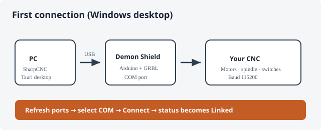

# 2. First connection

**Prefer pictures:** [First-run visual guide](../setup-visual/first-run.html) (Connect → Home → Calibrate → Travel → Stock).

SharpCNC ↔ GRBL over **USB serial** (Demon Shield). Baud **115200**.

## First-run wizard

Fresh install opens **First-run setup**. Finish or **Skip for now**. Reopen: **Menu → First-run setup…**.

## Connect (checklist)

1. Open SharpCNC (desktop).
2. **Refresh** ports → pick COM → **Connect**.
3. Wait for **Linked** + live Work / Machine.

On connect: soft reset (`Ctrl-X`).

## If it fails

| Symptom | Try |
|---------|-----|
| No ports | Unplug/replug, Refresh, cable / drivers |
| Wrong COM | Watch Device Manager while unplugging |
| Fault | Close other serial apps → reconnect |
| Mock label | Use `tauri dev` / installer, not `npm run dev` |

> **Safety:** Connect does not home. Look before you jog.

Next: [UI](03-understanding-the-ui.md) · [Calibration visual](../setup-visual/calibration.html)
