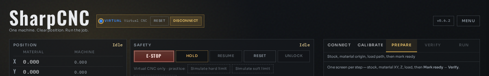

# 2. Connect (Phase 0)

**Goal:** A live GRBL session (or Virtual CNC) so position and safety mean something. Nothing else unlocks until you are linked.

**Order:** Connect → [Calibrate once](05-calibration.md) if the machine is new → [Prepare every job](07-prepare-and-z-probe.md) → Verify → Run. Pictures: [first-run bootstrap](../setup-visual/first-run.html) · [calibration](../setup-visual/calibration.html) · [prepare](../setup-visual/prepare.html).

SharpCNC ↔ GRBL over **USB serial** (Demon Shield). Baud **115200**.

## Practice first (recommended)

**Virtual CNC** is the safe default for a first-time operator. Pick it from the same port list as real COM ports. Finish Calibrate + one Prepare → Verify dry-run there before trusting real USB and soft limits.

Hint in the Connect UI: “Practice here before the real machine.”

## First-run wizard

Fresh install opens **First-run setup** — bootstrap into **Linked**, home, then **Calibrate** (machine, once). The optional stock step only seeds the first job; later cuts use **Prepare**. Finish or **Skip for now**. Reopen: **Menu → First-run setup…**.

## Connect (checklist)

1. Open SharpCNC (desktop).
2. On the **safety strip** / Connect controls: **Refresh** ports → pick **Virtual CNC** (practice) **or** your COM port → **Connect**.
3. Wait for **Linked** (USB) or **Virtual** (simulator) + live **Material / Machine** XYZ on the strip and visualizer.

On connect: soft reset (`Ctrl-X`).

### After you connect

- Machine **not** marked calibrated → land in **Calibrate**
- Already calibrated → land in **Prepare**

Disconnect returns you to Phase 0 (Connect).

## If it fails

| Symptom | Try |
|---------|-----|
| No ports | Unplug/replug, Refresh, cable / drivers — or choose **Virtual CNC** |
| Wrong COM | Watch Device Manager while unplugging |
| Fault | Close other serial apps → reconnect |
| Browser-only | `npm run dev` offers Virtual CNC only (no USB); use the desktop app for a real COM port |

> **Safety:** Connect does not home. Look before you jog.

Next: [Understanding the UI](03-understanding-the-ui.md) · [Calibration](05-calibration.md) (once)
