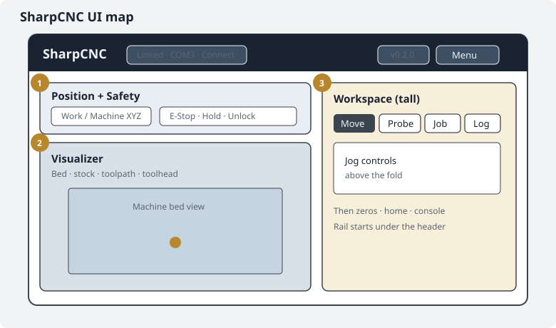
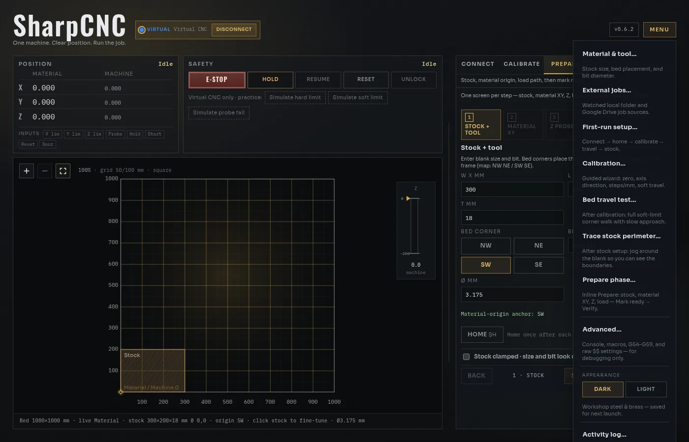

# 3. Understanding the UI

The window is built so you always see **connection**, **position**, and **safety**, with a large machine view and a slim workspace for Move / Job / Log.

## Header

- Brand: **SharpCNC**
- Tagline: one machine, clear position, run the job
- **Menu** — Material & tool, External jobs, Calibration, and **Debug mode** (wizards / panels that should not clutter the main chrome)

## Essentials strip (always visible)

Three blocks side by side:

1. **Connect** — port, baud note, Connect / Disconnect / Reset  
2. **Position** — Work and Machine X / Y / Z plus machine state (Idle, Jog, Run, Hold, Alarm, …)  
3. **Safety** — E-Stop, Hold, Resume, Reset, Unlock (+ alarm banner when locked)

Keep an eye on this strip while jogging or running. If state flips to **Alarm** or **Hold**, stop and read the banner before continuing.

## Visualizer (main stage)

Shows:

- Bed size from soft travel (default **1000 × 1000 mm** until you calibrate)
- Stock rectangle (from Material & tool)
- Loaded toolpath (job or SVG preview)
- Toolhead (bit Ø sized) with a short motion trail while jogging / running
- Optional **Simulate** overlay when a job path is loaded — preview only, not serial motion

Labels on the view call out bed size, stock, path name, and whether you are in preview or live motion.

## Workspace tabs (right rail)

| Tab | Contents |
|-----|----------|
| **Move** | Jog pad + work zero / go-to-zero |
| **Job** | Material & tool, External jobs, SVG → G-code, Load / Start / Simulate |
| **Log** | Live activity (TX/RX/events); with **Debug mode** on — export, Copy, Debug bridge |

Job tab can show a small badge (`Ready`, `Run`, `Held`, `SVG`, …) so you know job state at a glance.

## Menu vs tabs

Use **tabs** for day-to-day jog / run / logs. Use **Menu** for setup that you do occasionally:

- Material & tool…  
- External jobs…  
- Calibration… (full wizard modal)  
- **Debug mode** — toggle (persisted; default off). When on, the Log tab shows Export / Copy / Debug bridge and the menu label reads **Menu · Debug**.

Next: [Jogging & zeros](04-jogging-and-zeros.md).
