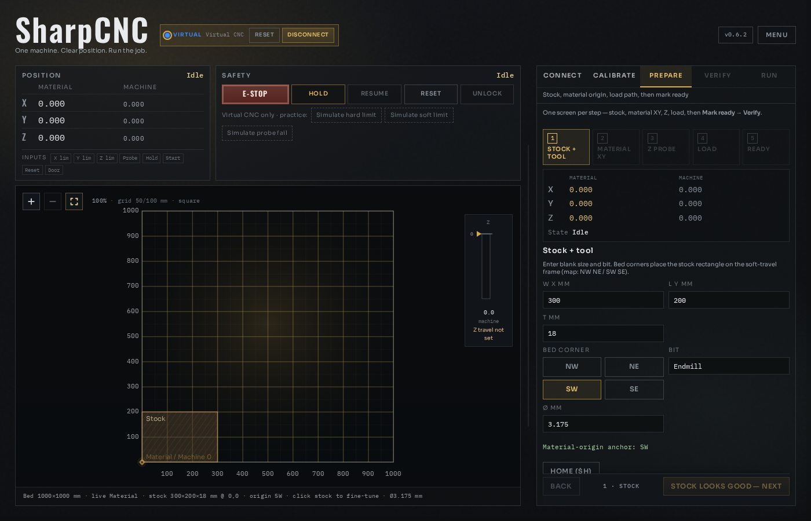

# 3. Understanding the UI

The window always shows **connection**, **Material / Machine position**, and **safety**. The big stage is the machine view. The right rail is a **phase body** — only the controls for the current task.

## Header

- Brand: **SharpCNC**
- Tagline: one machine, clear position, run the job
- **Connection chip** — compact Linked / Offline / Virtual status, port, Connect / Disconnect / Reset
- **Version chip** — opens **About & updates**; Update badge when a newer GitHub Release exists
- **Menu** — Material & tool, External jobs, Calibrate, Bed travel test, Trace stock perimeter, Prepare, **Advanced…**, **Appearance**, **Debug mode**, **About & updates…**

## Always-on safety strip

Above the visualizer (every phase, including before connect):

| Strip item | Role |
|------------|------|
| **Connect** | Port / Virtual CNC, Connect / Disconnect — Phase 0 lives here until linked |
| **Machine XYZ** | MPos — bed / soft-travel frame |
| **Material XYZ** | Job origin on the blank (WPos under the hood). Label **Material**, never “Work” |
| **State** | Idle / Jog / Run / Hold / Alarm |
| **Stop / Hold / Resume / Unlock** | E-Stop primary; Unlock after alarm |
| **Live overrides** | Feed % / spindle % — emphasized in Run / Hold |

**Machine XYZ** = where the machine thinks the tool is on the bed.  
**Material XYZ** = where the tool is relative to the origin you set on the blank.

## Visualizer (main stage)

Shows:

- Bed size from soft travel (default **1000 × 1000 mm** until you calibrate)
- Stock rectangle (from Prepare / Material & tool — set corner from toolhead, then W/L/T)
- Loaded toolpath (job or SVG preview)
- Toolhead (bit Ø sized) with a short motion trail while jogging / running
- **Dual origin** markers — **Material 0** at the job origin and **Machine 0** from WCO
- Optional **Simulate** overlay when a path is loaded — preview only, not serial motion

Axis convention (matches the guides): **+X** right, **+Y** back = up on screen, **+Z** up. Bed corners use map layout: **NW NE** on the top row, **SW SE** on the bottom.

## Phase switcher (right rail)

A persistent stepper: **Connect · Calibrate · Prepare · Verify · Run**. Incomplete phases ahead stay disabled with a one-line reason (“Mark material ready first”). Completed **Calibrate** stays unlocked for re-entry. Drag the thin handle between the visualizer and the rail to widen or narrow the panel (saved for next time). On narrow windows the layout stacks and the handle hides.

| Phase | What the pane shows |
|-------|---------------------|
| **Connect** | Ports, baud note, Connect, Virtual CNC |
| **Calibrate** | Four dense guided steps (one screen each) |
| **Prepare** | Stepped wizard: stock+tool → Material XY → Z → load → Mark ready |
| **Verify** | Soft-limit summary, Simulate, checklist, **Start** |
| **Run** | Progress + overrides + Pause / Resume / Stop |

**No scroll for primary phase controls** — each step fits on one screen. The visualizer and safety strip stay fixed; only the phase body swaps.

**Not phases:** Log / Debug (Menu · Debug) and **Advanced…** (Menu). Those are intentional hides and may scroll.

## Menu

Use **Menu** for occasional setup and power tools:

- Material & tool… / External jobs… / Trace stock perimeter… / Bed travel test…  
- Calibrate… / Prepare phase… / First-run setup…  
- **Advanced…** — console, macros, G54–G59, raw `$$` (closed by default; not part of normal cutting)  
- **Appearance** — Dark or Light (persisted)  
- **Debug mode** — Export / Serial / Copy / Debug bridge under Menu · Debug (TX/RX timestamps always logged)  
- **About & updates…** — version, GitHub Releases, in-app install

Next: [Jogging & zeros](04-jogging-and-zeros.md).
