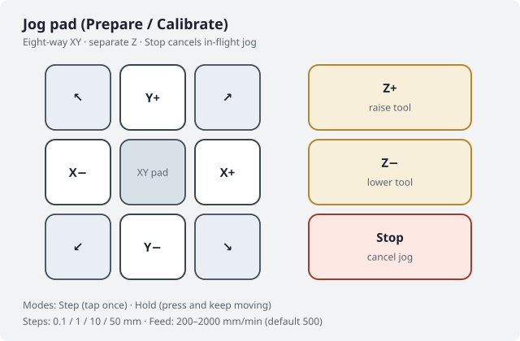
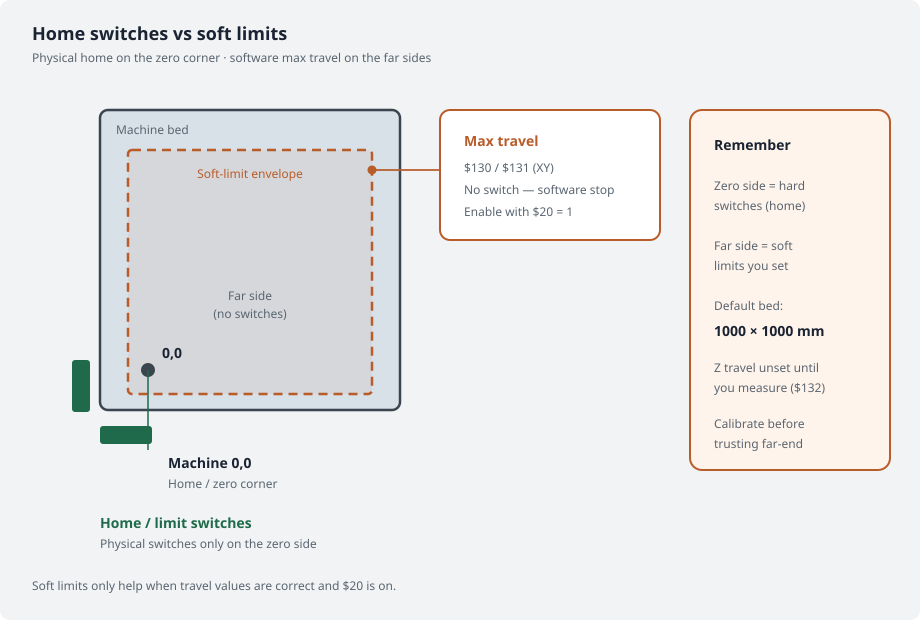

# 4. Jogging & zeros

Jog and material zero live in **Prepare** (day-to-day) and lightly in **Calibrate** (measurement). They are not Run controls.

Looking down on the bed (same as the visualizer): **+X** right, **+Y** back = up on screen, **+Z** up.

## Jog pad

Compact jog sits on the Prepare **Material XY** step (and in Calibrate when measuring).

### Modes

- **Step** — each tap moves the selected step size once  
- **Hold** — press and hold a direction to keep jogging; release to stop bursts; **Stop** cancels an in-flight jog (`0x85`)

### Step & feed

- **Step mm:** 0.1 · 1 · 10 · 50 (default **1**)  
- **Feed mm/min:** 200 · 500 · 1000 · 2000 (default **500**, hard-capped lower than full rapid)

Start slow near the stock. Use 0.1 mm when touching off Z.

### Xbox / gamepad

Plug an Xbox-layout controller into the PC. SharpCNC uses the browser Gamepad API (desktop WebView included). Mapping:

| Input | Action |
|-------|--------|
| Left stick | Jog XY (stick up = **Y+** / bed back) |
| LT / LB | **Z−** |
| RT / RB | **Z+** |
| D-pad | One step (uses Step mm) |
| B or Back | Stop / cancel jog (`0x85`) |

Sticks use a deadzone so rest noise does not creep. Works on **Virtual CNC** and a linked USB machine. Many browsers need one button press on the pad before it appears.

### Soft-limit awareness

SharpCNC refuses jogs that would push past known soft travel (when max X/Y/Z are set). You will see a soft-limit hint instead of motion. A jog that would overshoot stops at the edge; SharpCNC never sends a jog in the opposite direction to the one you pressed.

**Z is upside down compared to X and Y.** Z homes to the **top** of its travel, so machine Z is **0 at home and negative below it** (e.g. 0 down to −80 with `$132=80`). X and Y count up from their home side. The **Z gauge** at the top-right of the machine view shows where the tool tip is between home and the bottom of travel, plus material Z0, the stock, and the loaded job's Z range (red when the job would leave Z travel).

Your machine has **physical switches only on the zero side**. The far end of each axis is protected by **software** soft limits (`$130`–`$132` + `$20`). Calibrate those — do not rely on crashing into the far rail.

> **Safety:** Soft limits only help when travel values are correct and `$20` is on. Until you finish [Calibration](05-calibration.md), treat far-end travel as unprotected. Practice refusals on **Virtual CNC** first.

## Material zero (job origin)

**Machine** coordinates are from home / machine 0.  
**Material** coordinates are from the job origin on the blank (usually a stock corner).

Buttons under material zero (`G10 L20 · G54`):

- **Zero X / Y / Z / XYZ** — declare “here is material origin” for those axes. **Does not move** the machine.
- **Go to zero → X / Y / Z / All** — asks for confirm, then jogs to material zero. XY paths raise Z to material Z0 first when needed.

Confirm dialogs matter: **Confirm move** sends motion; **Cancel** does nothing.

Typical touch-off (Prepare phase):

1. Jog XY so the bit is over your stock origin.  
2. Jog Z carefully to touch the surface (paper feel), **or** use the [Prepare Z probe](07-prepare-and-z-probe.md).  
3. **Zero XYZ** (or Zero Z alone if XY already set).  
4. Raise Z before running anything.

> **Safety:** Never leave a spinning bit while leaning in to measure. Prefer power-off or spindle-off touch-offs when learning. Prefer the probe wizard for repeatable Material Z0.

## Homing

**Home ($H)** runs GRBL’s homing cycle against the **zero-side limit switches** (needs `$22=1`) — not the touch plate. **Rule of thumb: home once after every power-on, and again after an E-Stop or reset mid-move.** Everything else (soft limits, saved zeros, the Z gauge) depends on it. Home is offered in First-run, in Calibrate's **Start** step, and in Prepare step 1. SharpCNC marks the session **Homed** after a successful cycle. **Clear home** only drops that session flag — it does not wipe GRBL EEPROM.

After homing on stock GRBL, Z reads about **−1 mm** (minus the pull-off `$27`), not exactly 0: the switch trigger point is 0.

## XY probe & tool length

On the Prepare **Material XY** and **Z** steps:

**XY probe** runs `G38.2` along +X/−X or +Y/−Y, or an outside/inside **corner** sequence with bit-radius compensation. **Tool length (Z)** / stock-top Z uses the touch plate (same plate thickness as Prepare). Job Z0 for a cut prefers the Prepare Z probe step.

## Spindle & feed overrides

- **Spindle warm-up** (On / Off) can sit in Prepare when needed.  
- **Feed override** / **Spindle override** — GRBL 1.1 realtime percent steps. Emphasized on the safety strip during **Run** / Hold.

While a job runs, the strip shows **Feed / Rapid / Spindle %** (rapid is 100 / 50 / 25). Soft reset returns tracked overrides to 100%.

---

## Advanced appendix

Chris should not need this for daily cutting. One door only: **Menu → Advanced…**

| Control | Why it is Advanced |
|---------|--------------------|
| **Console** + send line | Raw GRBL; easy to break a session |
| **Macros** | Same surface as console |
| **G54–G59 work offsets** | Multi-fixture WCS; this machine uses Material XYZ / G10 for the blank |
| **Restore settings** | Re-apply a Calibrate auto-backup: changed-only diff, write one-by-one, re-read `$$` |
| **Manual `$$` / `$x=value`** | Free-form EEPROM; Calibrate already covers `$3`, steps/mm, soft travel |

### Restore a settings backup

1. Connect, then **Menu → Advanced…**.
2. Under **Restore settings**, pick a snapshot (auto-saved when Calibrate first loaded `$$`, or when you used **Back up settings**).
3. **Read $$** if the live list looks stale. The table shows only settings that differ (live → backup).
4. Click **Restore N settings**. SharpCNC writes those values one at a time, then re-reads `$$` to confirm.

Everyday Calibrate writes still have a session **Undo** next to the result message — prefer that for a single mistaken write. Use Restore when you want the whole pre-calibration dump back.

Day-to-day **Zero X/Y/Z** still uses `G10 L20` on the active system (usually G54). Dangerous lines like `$H` / `$RST=` are refused in the console — use Homing / Calibration instead.

Next: [Calibration](05-calibration.md).
