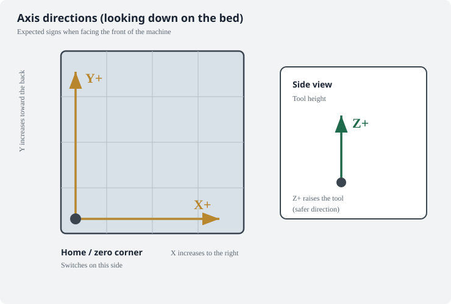
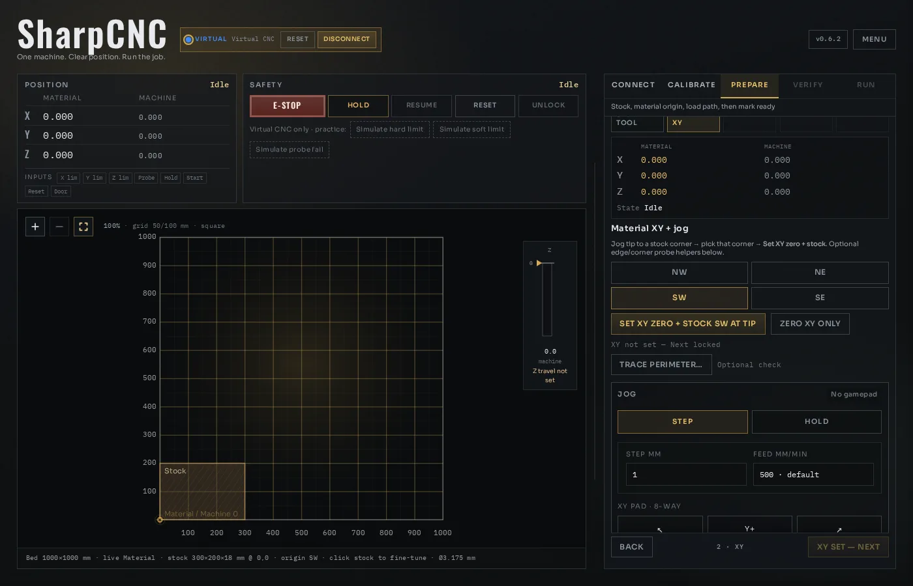
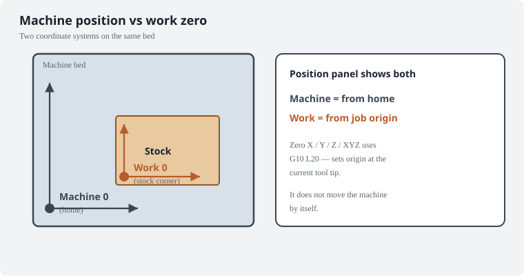

# 4. Jogging & zeros

Open the **Move** tab. This is how you nudge the machine and set a work origin before cutting.

## Jog pad

### Modes

- **Step** — each tap moves the selected step size once  
- **Hold** — press and hold a direction to keep jogging; release to stop bursts; **Stop** cancels an in-flight jog (`0x85`)

### Step & feed

- **Step mm:** 0.1 · 1 · 10 · 50 (default **1**)  
- **Feed mm/min:** 200 · 500 · 1000 · 2000 (default **500**, hard-capped lower than full rapid)

Start slow near the stock. Use 0.1 mm when touching off Z.

### Soft-limit awareness

SharpCNC refuses jogs that would push past known soft travel (when max X/Y/Z are set). You will see a soft-limit hint instead of motion.

Your machine has **physical switches only on the zero side**. The far end of each axis is protected by **software** soft limits (`$130`–`$132` + `$20`). Calibrate those — do not rely on crashing into the far rail.

> **Safety:** Soft limits only help when travel values are correct and `$20` is on. Until you finish [Calibration](05-calibration.md), treat far-end travel as unprotected.

## Work zero

**Machine** coordinates are from home / machine 0.  
**Work** coordinates are from the job origin (usually a stock corner).

Buttons under **Work zero** (`G10 L20 · G54`):

- **Zero X / Y / Z / XYZ** — declare “here is work origin” for those axes. **Does not move** the machine.
- **Go to zero → X / Y / Z / All** — asks for confirm, then jogs to work zero. XY paths raise Z to work Z0 first when needed.

Confirm dialogs matter: **Confirm move** sends motion; **Cancel** does nothing.

Typical touch-off:

1. Jog XY so the bit is over your stock origin.  
2. Jog Z carefully to touch the surface (paper feel / probe habit of your own).  
3. **Zero XYZ** (or Zero Z alone if XY already set).  
4. Raise Z before running anything.

> **Safety:** Never leave a spinning bit while leaning in to measure. Prefer power-off or spindle-off touch-offs when learning.

## Spindle & feed overrides (Move tab)

Below jog / zero:

- **Spindle RPM** — **On (M3)** sends `M3 S…`; **Off (M5)** stops PWM spindle.  
- **Feed override** / **Spindle override** — GRBL 1.1 realtime percent steps (−10 / −1 / 100% / +1 / +10). Work during a running job; soft limits unchanged.

Live F/S from status show when GRBL reports them. Soft reset returns tracked overrides to 100%.

Next: [Calibration wizard](05-calibration.md).
