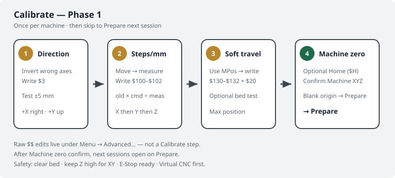
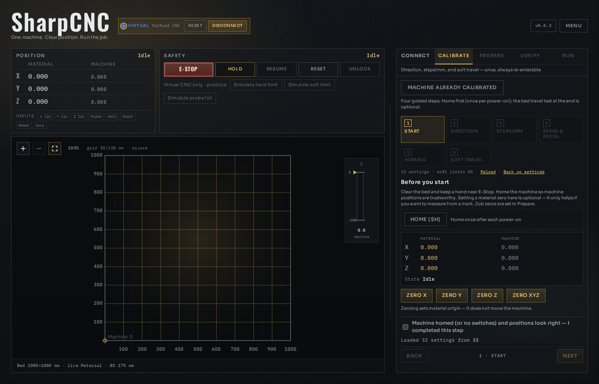
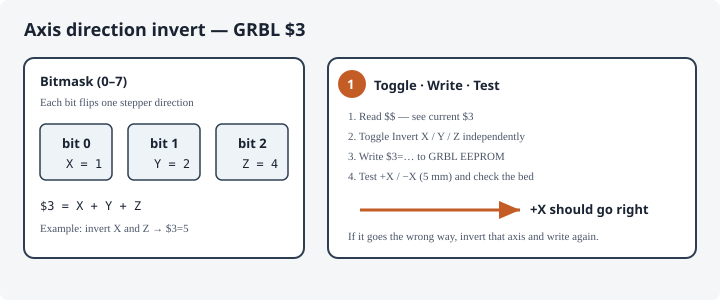
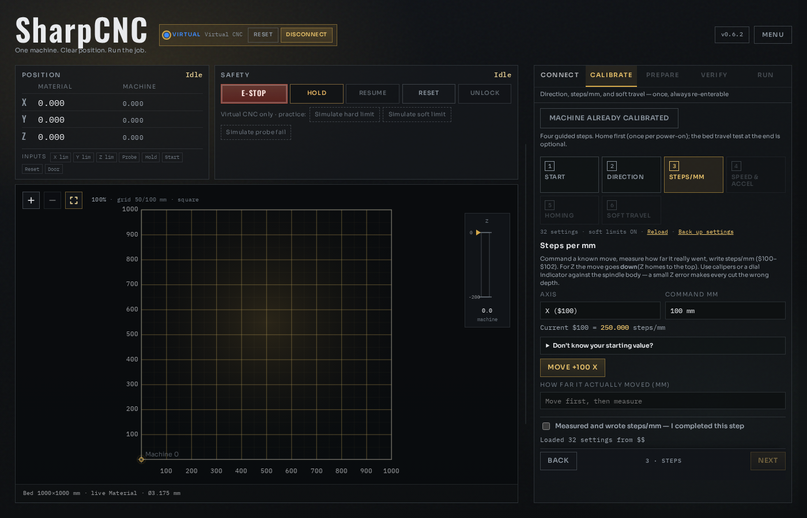
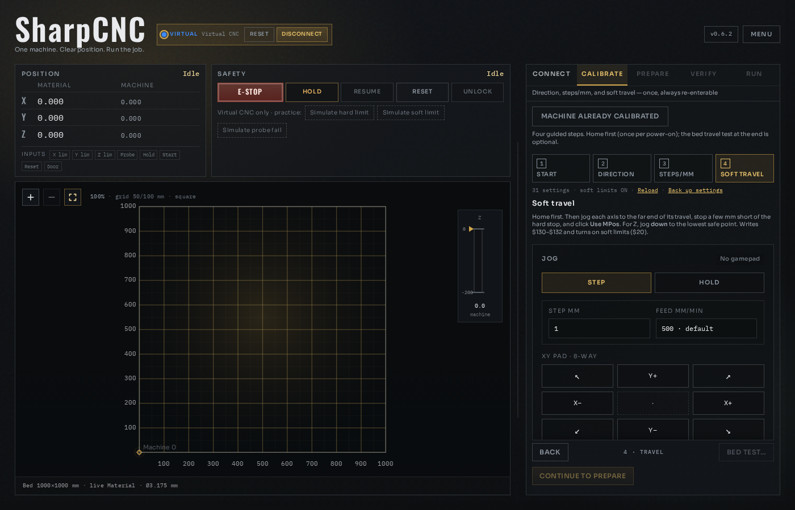
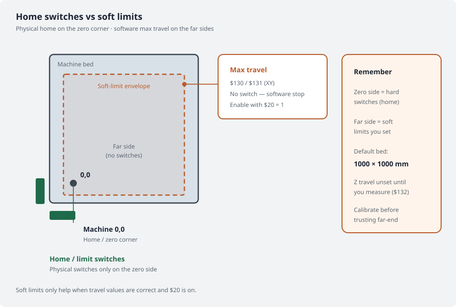
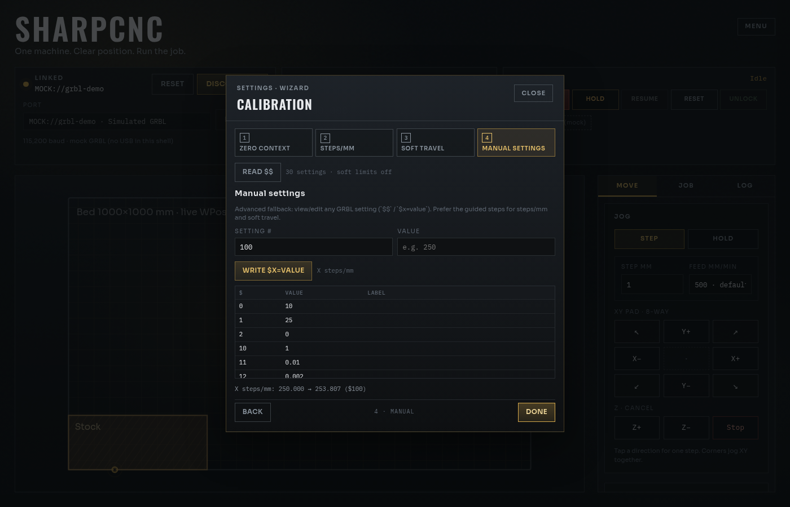

# 5. Calibration wizard

Menu → **Calibration…** opens a stepped wizard. Connect first; the wizard auto-reads `$$` when settings are unlocked.

## Wizard overview

| Step | Label | Goal |
|------|-------|------|
| 1 | **Zero context** | Confirm work / machine zero before measuring |
| 2 | **Axis direction** | Invert X/Y/Z steppers via `$3` so jog signs match the machine |
| 3 | **Steps/mm** | Known move → ruler → write `$100` / `$101` / `$102` |
| 4 | **Soft travel** | Max bed extents → `$130`–`$132`, enable `$20` |
| 5 | **Manual settings** | Advanced `$$` / `$x=value` fallback (includes `$3`) |

Footer: **Back** · **Next** (step 1 Next is **Zeros look good — Next**) · last step **Done**. You can also click step tabs directly. **Close** dismisses the modal.

Toolbar: **Read $$** anytime to refresh GRBL settings. Meta shows setting count and whether soft limits are ON.

> **Safety:** Calibration moves the machine. Clear the bed of tools and clamps you do not need. Keep Z high for XY measurements. Stand ready to hit **E-Stop**.

---

## Step 1 — Confirm zero context

1. Look at Work / Machine XYZ and the state line.  
2. If you use machine home, home first (outside this wizard if you home from GRBL elsewhere), then jog to a known reference.  
3. Set work origin with **Zero X / Y / Z / XYZ** if needed (same `G10 L20` as Move tab).  
4. Click **Zeros look good — Next**.

Zeroing here still **does not move** the machine — it only sets the work coordinate system.

---

## Step 2 — Axis direction invert (`$3`)

Do this **before** steps/mm if +X / +Y / +Z move the wrong way relative to the bed.

GRBL `$3` is a bitmask: **bit 0 = X (1)**, **bit 1 = Y (2)**, **bit 2 = Z (4)**. Sum the bits for every axis you want inverted (example: invert X and Z → `$3=5`).

### What to do

1. Confirm **Current $3** (click **Read $$** if it says —).  
2. Toggle **Invert X / Y / Z** independently to match how the machine is wired.  
3. Press **Write $3=…**.  
4. Use **Test +X / −X** (and Y / Z) — each jogs **5 mm** — and watch the tool.  
5. If a positive jog goes the wrong way, flip that axis toggle, write again, and re-test.

Expected signs (looking down on the bed): **+X** toward the right, **+Y** toward the back, **+Z** up. See also [diagram-axes.svg](assets/diagram-axes.svg).

You can still edit `$3` later in **Manual settings** if needed.

---

## Step 3 — Steps per mm (on the machine)

Do this for **X**, then **Y**, then **Z** (Z is trickier — use a dial indicator if you can).

### What to do physically

1. Mark a start point on the table / stock with a pencil, or set a dial indicator to zero against a fixed stop.  
2. In the wizard: choose **Axis** (X `$100` / Y `$101` / Z `$102`) and **Command mm** (50 / 100 / 200 — default 100).  
3. Confirm current `$N` is shown (click **Read $$** if it says —).  
4. Press **Move +100 X** (or whatever you chose). The machine jogs that commanded distance at the default calibration feed.  
5. Measure the **actual** travel with a ruler / caliper / indicator.  
6. Type that into **Measured mm (ruler)** (example: commanded 100, measured 98.5).  
7. Check Before / After.  
8. Press **Write $100=…** (or $101 / $102). GRBL stores the new steps/mm.  
9. Optionally move again and re-measure to verify.

Formula (handled for you):  
`new_steps = old_steps × (commanded / measured)`.

---

## Step 4 — Soft travel / bed extents

Because far-end switches do not exist on this machine, you teach GRBL how far is safe:

1. Jog carefully toward the far end of an axis (slow feed, hand on E-Stop). Stop with a little margin before mechanical crash.  
2. Click **Use MPos** for that axis — fills Max X/Y/Z from current machine position — or type the measured bed size (defaults for the visualizer are X/Y **1000 mm**; Z optional until known).  
3. Leave **Enable soft limits ($20=1)** checked unless you have a deliberate reason not to.  
4. Press **Write travel + $20**.  
5. Soft travel also updates the bed drawn in the visualizer (persisted in the app).

Repeat awareness for all axes you care about. Unknown Z max means the UI will not soft-block Z the same way — measure it when you can.

> **Safety:** Enabling `$20` without accurate `$130`–`$132` can either allow crashes or refuse valid moves. Measure, then write.

---

## Step 5 — Manual settings

For advanced tweaks:

1. **Read $$** if the table is empty.  
2. Click a row (or type Setting # + Value).  
3. **Write $x=value**.

Key rows are highlighted: `$3`, `$20`, `$100`–`$102`, `$130`–`$132`. Prefer the guided steps for those. Manual writes are blocked while a job is running.

Click **Done** when finished.

---

## After calibration

- Jog a known distance and spot-check with a ruler.  
- Confirm soft limits block an intentional over-travel jog (hint appears; no crash).  
- Recalibrate if belts slip, leadscrews change, or accuracy drifts.

Next: [Material & tool](06-material-and-tool.md).
