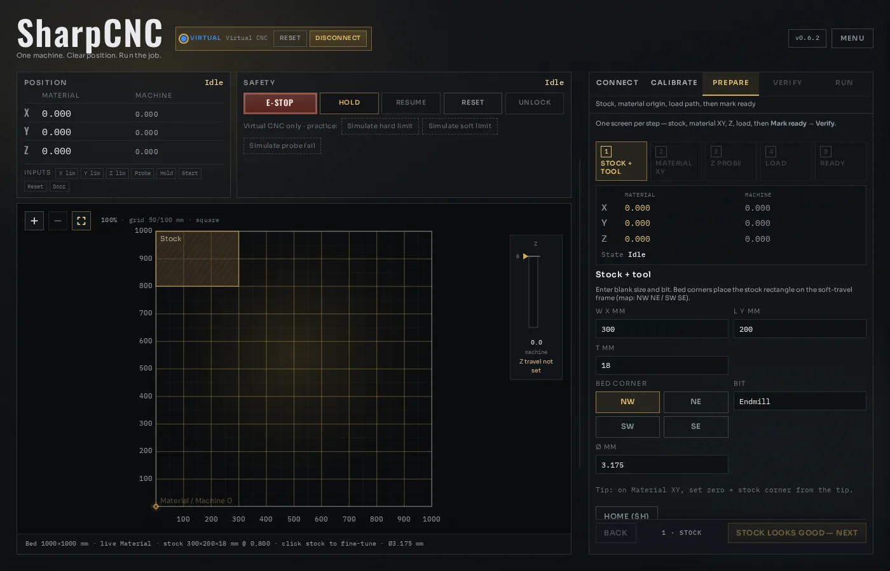
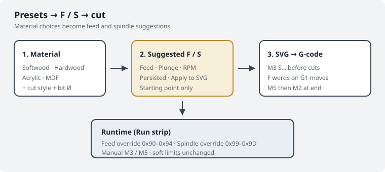

# 6. Material & tool

Tell SharpCNC what is on the bed and which bit is in the spindle. That drives the visualizer, SVG defaults, and clearance intuition.

Open from **Menu → Material & tool…** or scroll the **Job** tab.

## Stock (workpiece)

### Primary: corner from toolhead

1. Clamp the blank on the bed.  
2. Jog the tip to a stock corner (usually **SW** / front-left).  
3. Pick that corner and press **Set XY zero + stock … at tip** (Material & tool or Prepare → XY).  
4. Enter **Width / Length / Thickness**. Size grows away from the anchored corner; the visualizer updates with the same numbers.

That one action sets work XY zero (`G10 L20`) and stock origin together so the corner under the tip is work (0,0).

Optional: **Trace stock perimeter…** jogs the toolhead around the blank (safe Z, XY only) so you can see SharpCNC knows the boundaries — same flow as in Prepare → XY. Confirm the path is clear before Start.

### Fields

| Field | Meaning |
|-------|---------|
| **Width X mm** | Stock size along X (from the anchored corner) |
| **Length Y mm** | Stock size along Y |
| **Thickness mm** | Stock height (for awareness / future checks) |
| **Bed frame (optional)** | **SW** / **SE** / **NW** / **NE** against soft-travel bed — does **not** set work zero |
| **Offset X / Y mm** | Manual fine placement in work mm |

Defaults start around 300 × 200 × 18 mm. Values persist in the app.

### Optional fine-tune on the visualizer

Click the stock blank to select it, then drag to nudge or use side/corner handles to resize. Prefer the numeric fields for accuracy. Pan/zoom still work on empty bed (stock hit takes priority). Esc clears selection.

Place the physical sheet to match what you enter — the orange **Stock** rectangle on the visualizer should match reality.

## Bit (tool)

| Field | Meaning |
|-------|---------|
| **Type** | Endmill / Ballnose / V-bit / Engraving / Other |
| **Diameter Ø mm** | Used for tool marker size and SVG toolpath defaults (default ~3.175 mm) |
| **Tip angle °** | Shown for V-bits (1–179) |

> **Safety:** Wrong diameter does not stop the machine from cutting — it only affects preview / SVG generation. Always verify depth and tool in the G-code for real cuts.

## Feeds & speeds (material presets)

Pick a **material** (softwood, hardwood, acrylic, MDF) and **cut style** (engrave vs cut / outline). SharpCNC suggests feed, plunge, spindle RPM, and a depth starting point scaled to the current bit Ø. Values persist across launches; **Recalc from preset** refreshes from the table; **Apply to SVG** copies them into the SVG generate fields.

**Saved presets:** name the current F/S setup and **Save preset** for favorites (load / delete from the same panel).

These are hobby starting points — always test on scrap. Runtime feed / rapid / spindle **override percents** persist across relaunch and live on the essentials strip while a job runs (and on the **Move** spindle panel).

## Checklist before a job

1. Clamp stock; measure width / length / thickness.  
2. Jog tip to the job corner; **Set XY zero + stock … at tip**.  
3. Enter (or adjust) W / L / T — glance at the visualizer.  
4. Optional: **Trace stock perimeter…** to verify the blank bounds.  
5. Install the bit; enter diameter (and tip angle if V-bit).  
6. Pick material + cut style; apply suggested F/S to SVG if generating in-app.  
7. Probe / set Z to the top face you intend in CAM or SVG.

Next: [Prepare to run & Z probe](07-prepare-and-z-probe.md).
