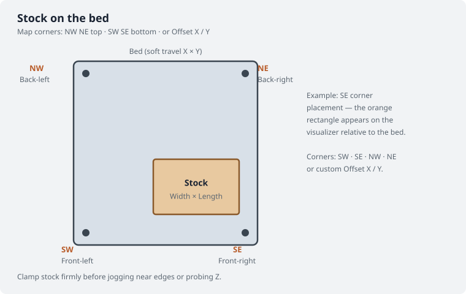

# 6. Material & tool

Tell SharpCNC what is on the bed and which bit is in the spindle. That drives the visualizer, SVG defaults, and clearance intuition.

Open from **Menu → Material & tool…** or scroll the **Job** tab.

## Stock (workpiece)

| Field | Meaning |
|-------|---------|
| **Width X mm** | Stock size along X |
| **Length Y mm** | Stock size along Y |
| **Thickness mm** | Stock height (for awareness / future checks) |
| **Corner on bed** | **SW** front-left · **SE** front-right · **NW** back-left · **NE** back-right |
| **Offset X / Y mm** | Manual placement from bed origin if not using a corner shortcut |

Corner buttons set offsets from the current bed size (soft travel). Defaults start around 300 × 200 × 18 mm at offset 0,0 until you change them. Values persist in the app.

Place the physical sheet to match what you enter — the orange **Stock** rectangle on the visualizer should match reality.

## Bit (tool)

| Field | Meaning |
|-------|---------|
| **Type** | Endmill / Ballnose / V-bit / Engraving / Other |
| **Diameter Ø mm** | Used for tool marker size and SVG toolpath defaults (default ~3.175 mm) |
| **Tip angle °** | Shown for V-bits (1–179) |

> **Safety:** Wrong diameter does not stop the machine from cutting — it only affects preview / SVG generation. Always verify depth and tool in the G-code for real cuts.

## Feeds & speeds (material presets)

Pick a **material** (softwood, hardwood, acrylic, MDF) and **cut style** (engrave vs cut / outline). SharpCNC suggests feed, plunge, spindle RPM, and a depth starting point scaled to the current bit Ø. Values persist; **Recalc from preset** refreshes from the table; **Apply to SVG** copies them into the SVG generate fields.

These are hobby starting points — always test on scrap. Runtime feed/spindle percent overrides live on the **Move** tab (not the essentials strip).

## Checklist before a job

1. Measure the stock with a tape; enter width / length / thickness.  
2. Clamp stock; pick the corner that matches how you will zero the job.  
3. Install the bit; enter diameter (and tip angle if V-bit).  
4. Pick material + cut style; apply suggested F/S to SVG if generating in-app.  
5. Zero work coordinates to the same corner / top face you intend in CAM or SVG.  
6. Glance at the visualizer — stock and path should overlap sensibly.

Next: [Jobs, SVG & run](07-jobs-and-svg.md).
