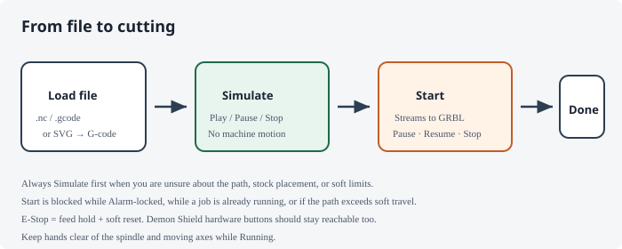
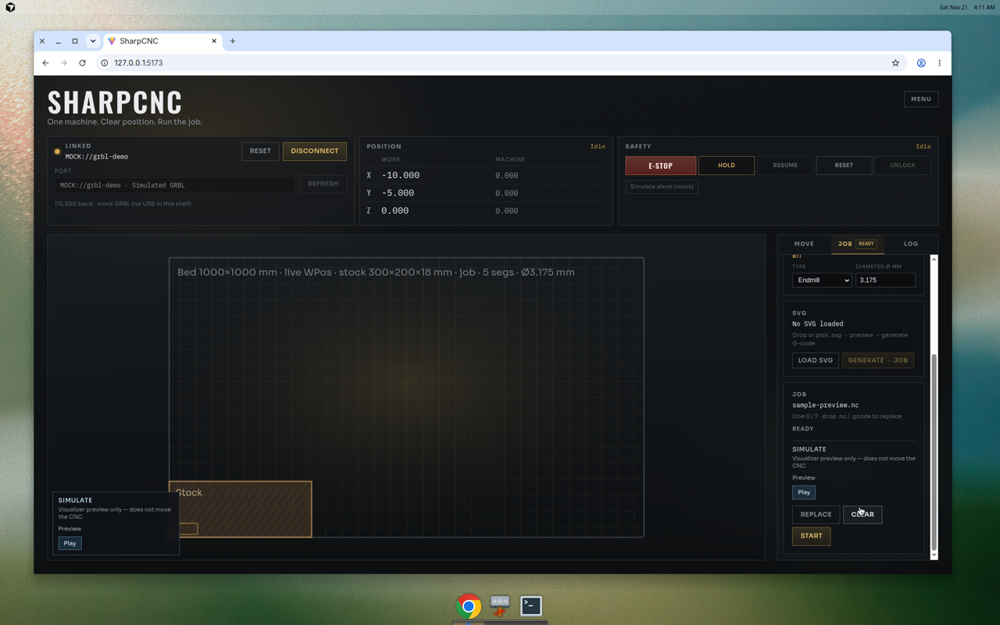

# 7. Jobs, SVG & run

The **Job** tab is where files become motion. Flow: load (or generate) → simulate → start.

## Load G-code

Under **Job**:

1. **Load** (or drag-drop) a `.nc` / `.gcode` / `.ngc` / `.tap` file.  
2. Confirm line count and path overlay on the visualizer.  
3. Soft-limit check runs against known travel — if the path is outside, Start stays blocked with a reason.

**Replace** swaps the file; **Clear** removes it.

## SVG → simple G-code

SharpCNC is **not** full CAM. For simple 2D engraving / outline:

1. **Load SVG** (or drop `.svg`). Paths preview on the bed.  
2. Set **Mode**: Engrave (follow path) or Outline (closed contour).  
3. Set **Feed**, **Plunge**, **Depth**, **Safe Z**, and **Spindle RPM**. Bit Ø comes from Material & tool; use **Apply to SVG** there to pull material presets.  
4. **Generate → Job** hands the G-code to the job runner (one job at a time). Generated jobs include `M3 S…` before cuts and `M5` before program end (omit spindle words if RPM is 0).

Always simulate after generate. Depth is into the material — double-check sign/convention and stock thickness before Start.

## Simulate (preview only)

**Simulate** animates the toolhead along the path **without sending motion to the CNC**.

- **Play** / **Resume** / **Replay**  
- **Pause**  
- **Stop**

Available in the Job panel and as an overlay on the visualizer when a path exists. Disabled while a real job is streaming — stop the job first.

Banner: **Preview — not sending to CNC**.

## Start / Pause / Resume / Stop

| Button | What it does |
|--------|----------------|
| **Start** | Streams G-code to GRBL (needs Linked, Idle-capable state, soft-limit OK) |
| **Pause** | Feed hold (`!`) |
| **Resume** | Cycle start (`~`) from Hold |
| **Stop** | Soft reset / cancel stream — treat as abort |

Progress shows line counts and a bar. State badges: Ready / Running / Held / Stopping / Done / Error.

Hardware **start / pause / stop** buttons on the Demon Shield are part of the product plan — keep them reachable; the UI mirrors job state when presses are detected.

> **Safety:** Stay at the machine while Running. Know where **E-Stop** is (UI and physical). Do not Start if clamps, bit, or soft travel look wrong. When in doubt, Simulate again or jog a dry pass with Z raised.

## Alarms during a job

If GRBL alarms (limit, abort, etc.):

1. Spindle / motion stop — respect the machine.  
2. Read the **Alarm lock** banner.  
3. Clear the physical cause.  
4. **Unlock** (`$X`) only when safe.  
5. Re-zero / re-check before Start again.

See [Safety](10-safety.md).

Next: [External jobs](08-external-jobs.md).
