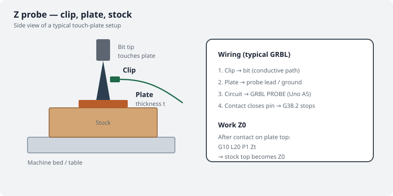

# 7. Prepare & Z probe (Phase 2)

**When:** every new job (after the machine is already [calibrated](05-calibration.md)). Prepare is **not** calibration — it does not set `$3`, steps/mm, or soft travel.

**Prefer pictures:** [Prepare visual](../setup-visual/prepare.html) · next phase [Verify](../setup-visual/verify.html).

**Session order:** Connect → (Calibrate if needed) → **Prepare** → **Mark ready → Verify** → Simulate → **Start** → **Run**.

The **Prepare** phase is a stepped inline wizard (one screen per step — no tall scroll stack). It confirms stock and tool, sets **Material XY**, runs a Z probe (or manual Z zero), loads the path, then **Mark ready** unlocks **Verify** (not Start). Opening a new file or disconnecting clears Prepared.

## When to open it

- Phase switcher → **Prepare** (after Calibrate is done)  
- **Menu → Prepare phase…** / **Material & tool…** / **External jobs…**  
- Clicking **Start** from Verify while material is not ready sends you back to Prepare  

Prepare is **required before Verify/Start** until you finish **Mark ready** for the current session. Loading a new job or disconnecting clears that ready flag. **Simulate** still works once a path is loaded even if not ready (preview only).

> **Safety:** Preparing moves Z during probe. Clear clamps from the seek path. Keep E-Stop reachable. Remove the plate before cutting.

---

## Wizard steps

| Step | Goal |
|------|------|
| 1 · Stock + tool | Size / thickness / bed corner (map: NW NE / SW SE) + bit type and diameter on one dense screen |
| 2 · Material XY | Jog tip to a stock corner → **Set XY zero + stock … at tip** (`G10 L20` + stock origin). Compact jog + optional XY edge/corner probe. Optional: **Trace perimeter…** |
| 3 · Z probe | Touch plate on **stock top** (or **Manual Zero Z**), retract, confirm plate removed / clamps clear |
| 4 · Load | G-code file, recent, or SVG generate; external folder/Drive behind one button |
| 5 · Ready | Short checklist → **Mark ready → Verify** |

Footer **Next** stays disabled until that step’s confirmations are done (checkboxes, zeros, probe, path loaded).

### Optional: Trace stock perimeter

After stock size + Material XY origin are set, **Trace stock perimeter…** (Prepare → Material XY, Material & tool, or **Menu**) walks the toolhead around the blank rectangle: safe Z retract, then cancelable `$J=` cruise/approach at the four corners. Confirmation gate required (path clear, plate removed, spindle off recommended). XY only — does not cut. Use Stop / Abort / Hold like the bed travel test. Soft limits must still contain the blank.

**Homing is separate:** `$H` uses zero-side limit switches. The touch plate is only for Z (and optional XY edge probe) — never for home.

---

## Touch plate setup

Chris’s hardware path: conductive plate on the **stock top**, alligator clip on the bit. Contact closes the GRBL probe input. Enter plate thickness (~15–20 mm for his plate); SharpCNC offsets so the stock face is **Material Z0**. Plate on the bare bed would zero the bed instead of the stock top — wrong for top-of-stock cuts.

### Assumptions (verify on Demon Shield)

1. **Probe pin** is wired to GRBL’s PROBE input (Arduino Uno GRBL 1.1 default **A5**). Demon Shield should expose this the same way as a stock Uno shield — confirm continuity from plate/clip to that pin.  
2. **`$6` probe invert** matches your polarity (normally-open plate vs inverted wiring). Wrong invert → Alarm 5 (already contacting) or never-trigger.  
3. Soft limits (`$20` / `$130`–`$132`) allow the seek distance downward from your start Z.  
4. Spindle / bit is conductive enough for the clip; coatings or collet isolation can break the circuit.  
5. Plate thickness is measured accurately — SharpCNC sets Material Z0 at the **stock face** by offsetting that thickness.

---

## Probe cycle (what SharpCNC sends)

1. Gate: connected, Idle-capable, not Alarm / Hold / streaming; probe pin not already ON.  
2. `G91` then `G38.2 Z-{seek} F{feed}` (default seek 30 mm, feed 80 mm/min — editable in the wizard).  
3. On success: `[PRB:x,y,z:1]` then `ok`.  
4. `G90` then `G10 L20 P1 Z{plateThickness}` so stock top is Material Z0.  
5. Optional retract jog to a safe material Z.

| Failure | Meaning |
|---------|---------|
| **ALARM:4** | No contact within seek — raise start height, check wiring, or increase seek |
| **ALARM:5** | Probe already active at start — clear contact / invert `$6` |
| Pin already ON | UI refuses to seek (same early-contact risk) |

**Manual Zero Z** is the paper-feel fallback (`G10 L20 P1 Z0` at the current tip) if the plate is unavailable.

---

## After Mark ready

1. Phase switcher unlocks **Verify**.  
2. **Start** lives in Verify (still needs Linked + Idle-capable + soft-limit OK).  
3. Prefer **Simulate** once more in Verify, then Start.  
4. Hardware Demon Shield start button follows the same Start gate.

If you change material zeros after marking ready, run Prepare again if you want the session flag to match — loading a new file always requires Prepare again.

Next: [Jobs, SVG & run](08-jobs-and-svg.md).
