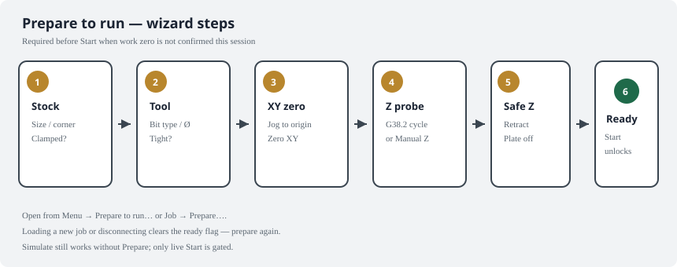
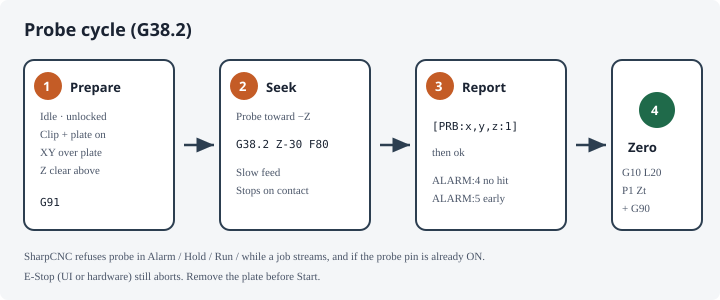

# 7. Prepare to run & Z probe

**When:** every new job (after the machine is already [calibrated](05-calibration.md)). Prepare is **not** calibration — it does not set `$3`, steps/mm, or soft travel.

**Prefer pictures:** [Per-job prepare visual](../setup-visual/prepare.html).

Before **Start**, SharpCNC walks you through a stepped **Prepare to run** wizard (same modal style as Calibration). It confirms stock and tool, sets work XY, runs a Z probe (or manual Z zero), then unlocks Start for this session.

## When to open it

- **Job → Prepare…** (after a file is loaded)  
- **Menu → Prepare to run…**  
- Clicking **Start** while work zero is not confirmed opens the wizard  

Prepare is **required before Start** until you finish **Mark ready** for the current session. Loading a new job or disconnecting clears that ready flag. **Simulate** still works without Prepare.

> **Safety:** Preparing moves Z during probe. Clear clamps from the seek path. Keep E-Stop reachable. Remove the plate before cutting.

---

## Wizard steps

| Step | Goal |
|------|------|
| 1 · Stock | Confirm size / thickness / bed corner (same settings as Material & tool) |
| 2 · Tool | Confirm bit type and diameter |
| 3 · XY zero | Jog tip to a stock corner → **Set XY zero + stock … at tip** (`G10 L20` + stock origin). **Zero XY only** is available as a fallback. Optional: **Trace stock perimeter…** (safe-Z XY jog around the blank) |
| 4 · Z probe | Touch plate on **stock top** (or **Manual Zero Z** paper-feel) |
| 5 · Safe Z | Retract; **remove plate** before cut; confirm clear |
| 6 · Ready | **Mark ready & close** → Start unlocks |

Footer **Next** stays disabled until that step’s confirmations are done (checkboxes, zeros, probe).

### Optional: Trace stock perimeter

After stock size + XY origin are set, **Trace stock perimeter…** (Prepare → XY, Material & tool, or **Menu**) walks the toolhead around the blank rectangle: safe Z retract, then cancelable `$J=` cruise/approach at the four corners. Confirmation gate required (path clear, plate removed, spindle off recommended). XY only — does not cut. Use Stop / Abort / Hold like the bed travel test. Soft limits must still contain the blank.

**Homing is separate:** `$H` uses zero-side limit switches. The touch plate is only for Z (and optional XY edge probe) — never for home.

---

## Touch plate setup

Chris’s hardware path: conductive plate on the **stock top**, alligator clip on the bit. Contact closes the GRBL probe input. Enter plate thickness (~15–20 mm for his plate); SharpCNC offsets so the stock face is work Z0. Plate on the bare bed would zero the bed instead of the stock top — wrong for top-of-stock cuts.

### Assumptions (verify on Demon Shield)

1. **Probe pin** is wired to GRBL’s PROBE input (Arduino Uno GRBL 1.1 default **A5**). Demon Shield should expose this the same way as a stock Uno shield — confirm continuity from plate/clip to that pin.  
2. **`$6` probe invert** matches your polarity (normally-open plate vs inverted wiring). Wrong invert → Alarm 5 (already contacting) or never-trigger.  
3. Soft limits (`$20` / `$130`–`$132`) allow the seek distance downward from your start Z.  
4. Spindle / bit is conductive enough for the clip; coatings or collet isolation can break the circuit.  
5. Plate thickness is measured accurately — SharpCNC sets work Z0 at the **stock face** by offsetting that thickness.

---

## Probe cycle (what SharpCNC sends)

1. Gate: connected, Idle-capable, not Alarm / Hold / streaming; probe pin not already ON.  
2. `G91` then `G38.2 Z-{seek} F{feed}` (default seek 30 mm, feed 80 mm/min — editable in the wizard).  
3. On success: `[PRB:x,y,z:1]` then `ok`.  
4. `G90` then `G10 L20 P1 Z{plateThickness}` so stock top is work Z0.  
5. Optional retract jog to a safe work Z.

| Failure | Meaning |
|---------|---------|
| **ALARM:4** | No contact within seek — raise start height, check wiring, or increase seek |
| **ALARM:5** | Probe already active at start — clear contact / invert `$6` |
| Pin already ON | UI refuses to seek (same early-contact risk) |

**Manual Zero Z** is the paper-feel fallback (`G10 L20 P1 Z0` at the current tip) if the plate is unavailable.

---

## After Prepare

1. Job tab shows **Prepared** instead of Prepare….  
2. **Start** is allowed (still needs Linked + Idle-capable + soft-limit OK).  
3. Prefer **Simulate** once more, then Start.  
4. Hardware Demon Shield start button follows the same Start gate.

If you change zeros on the Move tab after marking ready, run Prepare again if you want the session flag to match — loading a new file always requires Prepare again.

Next: [Jobs, SVG & run](08-jobs-and-svg.md).
