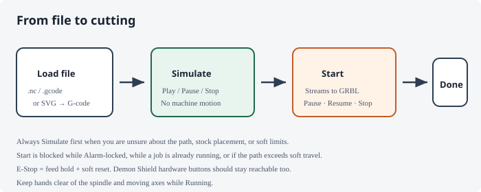
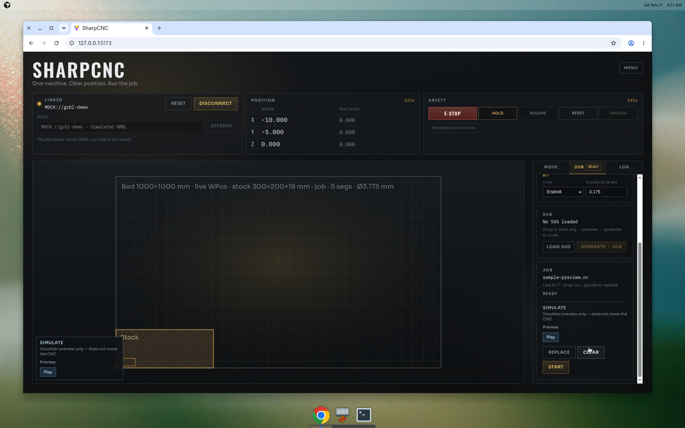

# 8. Jobs, SVG & run

Files become motion across phases: **Prepare** (load / generate + place) → **Verify** (soft-limit check, simulate, clear-path checklist, Start) → **Run** (progress, overrides on the safety strip, Hold / Stop). Start is only available in Verify.

Visual: [Load the job](../setup-visual/prepare.html#p1) in the per-job prepare guide.

Before the first **Start** after load (or whenever work zero is not confirmed this session), run **Prepare…** — see [Prepare to run & Z probe](07-prepare-and-z-probe.md). Load **before** Mark ready: opening a new file clears the Prepared flag.

## Load G-code

Under **Job**:

1. **Load** (or drag-drop) a `.nc` / `.gcode` / `.ngc` / `.tap` file.  
2. Confirm line count and path overlay on the visualizer — the drawing should sit on the stock rectangle.  
3. Soft-limit check runs against known travel — if the path is outside, Start stays blocked with a reason.

**Replace** swaps the file; **Clear** removes it.

**ELI5:** G-code is a ready-made shopping list of moves. Until you Load it, SharpCNC has nothing to draw on the bed or send to the machine.

## SVG → simple G-code

SharpCNC is **not** full CAM. For simple 2D engraving / outline:

1. **Load SVG** (or drop `.svg`), or tap a built-in **Sample**. Paths preview on the bed.  
2. Set **Mode**: Engrave (follow path) or Outline (closed contour).  
3. Set **Feed**, **Plunge**, **Depth**, **Safe Z**, and **Spindle RPM**. Bit Ø comes from Material & tool; use **Apply to SVG** there to pull material presets.  
4. **Generate → Job** hands the G-code to the job runner (one job at a time). Generated jobs include `M3 S…` before cuts and `M5` before program end (omit spindle words if RPM is 0).

**ELI5:** SVG is a picture. Generate turns that picture into cutting steps. Always check it on the stock before Start.

Always simulate after generate. Depth is into the material — double-check sign/convention and stock thickness before Start.

## Cut-size samples

SharpCNC ships **real-mm** sample SVGs so you can load → place on stock → cut → measure without guessing units. Each file sets `width`/`height` in `mm` and a matching `viewBox`, so **100 mm in the SVG is 100 mm in the app**.

| Sample | In app | File |
|--------|--------|------|
| **100×100 mm square** (primary) | Job → SVG → **Samples → 100×100 mm** | [sample-100mm-square.svg](assets/samples/sample-100mm-square.svg) |
| 50×50 mm square | **Samples → 50×50 mm** | [sample-50mm-square.svg](assets/samples/sample-50mm-square.svg) |
| 100 mm line (+ end ticks) | **Samples → 100 mm line** | [sample-100mm-line.svg](assets/samples/sample-100mm-line.svg) |

**How to use**

1. Finish [calibration](05-calibration.md) (especially steps/mm) if the machine is new or changed.  
2. Job tab → **SVG** → pick a **Sample** (or open the file from `assets/samples/`). Confirm the size chip (e.g. `100.0×100.0 mm`).  
3. Choose **Engrave** or **Outline**, set a shallow depth, **Generate → Job**.  
4. **Prepare…** (stock, XY, Z) so the path sits on the scrap you will cut.  
5. **Simulate**, then **Start** (or spindle-off dry run first).  
6. Measure the cut with a ruler/calipers. If the square is not 100 mm, revisit steps/mm — do not “scale the SVG.”

Repo copies also live under `public/samples/` for the desktop/web build.

## Simulate (preview only)

**When it fits:** after the file is loaded (and ideally after Prepare zeros so the picture matches the real wood). Optional early look right after Load; preferred full dress rehearsal after Mark ready, before Start.

**Simulate** animates the toolhead along the path **without sending motion to the CNC**.

- **Play** / **Resume** / **Replay**  
- **Pause**  
- **Stop**  
- **Speed** — 0.25× / 0.5× / 1× (default) / 2× / 4× so you can slow down to watch lifts and shallow passes, or speed through a long path

During play, SharpCNC shows Z cues so lifts and depth are obvious:

- Status line: **Retract**, **Plunge**, **Cut Z=…**, or **Rapid** with the live work Z  
- Toolhead stem grows when lifted / retracting; trail color shifts for retract vs plunge vs cut  
- Position readout Z tracks the preview (still preview-only)

Available in the Job panel and as an overlay on the visualizer when a path exists. Disabled while a real job is streaming — stop the job first.

Banner: **Preview — not sending to CNC**.

## Scrubber, skip-to-line, time estimate, dry run

With a job loaded (and not streaming):

- **Start at line** scrubber — next **Start** begins at that line (preview shows the G-code).  
- Rough **time estimate** from path length (feed vs rapid assumptions).  
- **Spindle-off dry run** — strips `M3`/`M4`/`S` and forces `M5` so you can air-cut without spinning the bit.

## Start / Pause / Resume / Stop

| Button | What it does |
|--------|----------------|
| **Prepare…** | Opens the pre-start wizard (stock, tool, XY, Z probe). Shows **Prepared** when ready. |
| **Start** | Streams G-code to GRBL (needs Linked, Idle-capable state, soft-limit OK, **and** Prepare ready). Honors scrubber + dry-run. |
| **Pause** | Feed hold (`!`) |
| **Resume** | Cycle start (`~`) from Hold |
| **Resume after tool change** | Continues past an `M6` pause after you change the bit |
| **Stop** | Soft reset / cancel stream — treat as abort |

Progress shows line counts and a bar. State badges: Ready / Running / Held / Tool change / Stopping / Done / Error.

When the stream hits **`M6`**, SharpCNC pauses for a tool change. Change the bit, then **Resume after tool change**.

Hardware **start / pause / stop** buttons on the Demon Shield stay in sync; Start from hardware respects the same Prepare gate.

> **Safety:** Stay at the machine while Running. Know where **E-Stop** is (UI and physical). Do not Start if clamps, bit, or soft travel look wrong. When in doubt, Simulate again or use **spindle-off dry run** with Z raised.

## Alarms during a job

If GRBL alarms (limit, abort, etc.):

1. Spindle / motion stop — respect the machine.  
2. Read the **Alarm lock** banner.  
3. Clear the physical cause.  
4. **Unlock** (`$X`) only when safe.  
5. Re-zero / re-check before Start again.

See [Safety](11-safety.md).

Next: [External jobs](09-external-jobs.md).
