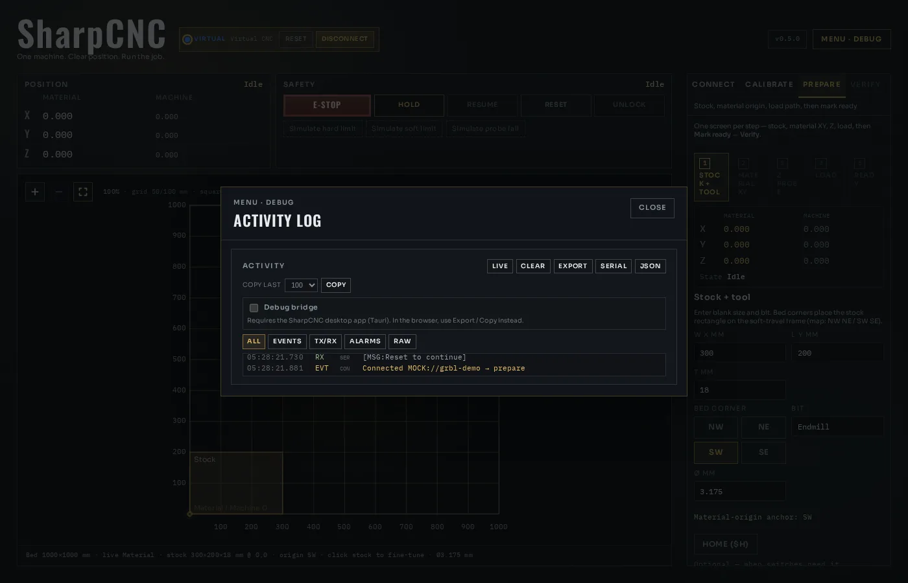

# 9. Debug bridge (troubleshooting with an AI agent)

When something odd happens on the real machine, SharpCNC can share **read-only** status and logs with a Cursor agent on the **same Windows PC**.



## Debug mode (show / hide toolkit)

Everyday UI keeps the **Log** tab lean. Turn on **Debug mode** only when you need the AI-assisted toolkit.

1. Open **Menu**.  
2. Check **Debug mode** (persisted across sessions; default **off**).  
3. The menu trigger shows **Menu · Debug** while it is on.  
4. Open the **Log** tab — Export, Copy, Debug bridge, Raw filter, and category tags appear.

Turn **Debug mode** off again to hide that chrome (and stop the localhost bridge if it was running). Live / Clear / basic filters stay available either way.

## With Debug mode on (no bridge required)

On the **Log** tab:

- Live TX / RX / events / alarms  
- Filters: All · Events · TX/RX · Alarms · Raw  
- **Export** (`.log`) · **JSON** · **Copy last** 50 / 100 / 200 lines  

Paste or attach those into chat if the bridge is off.

## Optional localhost bridge (desktop only)

1. Run SharpCNC desktop (`npm run tauri dev` or release).  
2. Menu → enable **Debug mode**.  
3. Open **Log**.  
4. Check **Debug bridge**.  
5. Confirm it listens on `http://127.0.0.1:17832`.

### Security

- Debug mode and the bridge are both **off by default**  
- Bridge binds **127.0.0.1 only** (not LAN / internet)  
- **Read-only** in this version — no jog, e-stop, or G-code via HTTP  
- Do **not** port-forward or tunnel this port  

### Handy curls (same machine)

```bash
curl -s http://127.0.0.1:17832/health
curl -s http://127.0.0.1:17832/v1/status
curl -s "http://127.0.0.1:17832/v1/logs?limit=80"
curl -s http://127.0.0.1:17832/v1/snapshot
```

| Endpoint | Returns |
|----------|---------|
| `/health` | ok / port / readonly |
| `/v1/status` | Connection, MPos/WPos, job phase, soft travel |
| `/v1/logs?limit=N` | Recent structured entries |
| `/v1/snapshot` | Status + recent logs |
| `/v1/export.txt` | Plain-text log |

Suggested workflow: enable Debug mode + the bridge, reproduce the issue once, let the agent poll status/logs, correlate alarms with position and job phase.

> **Safety:** The bridge cannot stop the machine. Keep using **E-Stop** / Demon Shield buttons / UI Hold for real emergencies.

Next: [Safety](10-safety.md).
