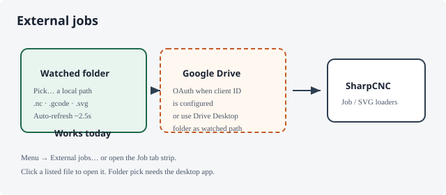

# 9. External jobs folder

Keep job files in a folder SharpCNC watches, then click to open them into the normal Job / SVG loaders.

## Open the panel

- **Menu → External jobs…**, or  
- **Job** tab → **External jobs** section

## Watched local folder (works today)

1. Click **Pick…** (desktop app required).  
2. Choose a folder that contains `.nc` / `.gcode` / `.svg` files.  
3. Path is remembered across sessions.  
4. Leave **Auto-refresh** on to re-list about every **2.5 s** (or hit **Refresh**).  
5. Click a file row to load it.

**Change…** / **Clear** manage the path. If the folder goes missing (USB unplugged), you will see a folder-missing hint — pick it again.

### Handy folder choices

- A project folder on the CNC PC  
- A USB stick  
- A network share  
- Your **Google Drive for Desktop** sync folder (jobs appear without OAuth)

## Google Drive (optional / scaffolded)

Native Drive OAuth appears when `VITE_GOOGLE_DRIVE_CLIENT_ID` is set. Until then the UI shows **Setup needed**.

Full steps (Cloud Console client ID, redirect `http://127.0.0.1:17833/oauth/callback`, scopes): see **[Google Drive setup](../google-drive-setup.md)**.

Practical approach today: point the watched folder at Drive for Desktop.

> **Safety:** Opening a file does not run it. Still Simulate and verify stock / zeros before Start.

Next: [Debug bridge](10-debug-bridge.md).
