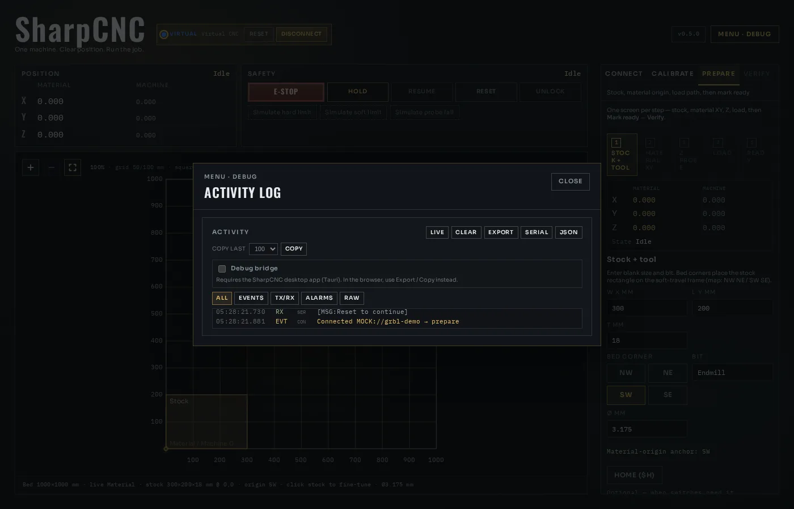

# 10. Debug bridge (troubleshooting with an AI agent)

When something odd happens on the real machine, SharpCNC can share **read-only** status and logs with a Cursor agent on the **same Windows PC**.

Debug / Log is **not** a task phase — it lives under **Menu · Debug** (beside Advanced).

## Debug mode (show / hide toolkit)

Everyday UI keeps the phase chrome lean. Turn on **Debug mode** only when you need the AI-assisted toolkit.

1. Open **Menu**.  
2. Check **Debug mode** (persisted across sessions; default **off**).  
3. The menu trigger shows **Menu · Debug** while it is on.  
4. Open the activity log / Debug panel — Export, Copy, Debug bridge, Raw filter, and category tags appear.

Turn **Debug mode** off again to hide that chrome (and stop the localhost bridge if it was running). Live / Clear / basic filters stay available either way.

## With Debug mode on (no bridge required)

- Live TX / RX / events / alarms with **timestamps** on every line  
- Filters: All · Events · TX/RX · Alarms · Raw  
- **Export** (`.log`, ISO + local timestamps) · **Serial** (TX/RX/ALARM transcript for failed-run replay) · **JSON** (includes `atIso`) · **Copy last** 50 / 100 / 200 lines  

Serial TX/RX logging is **always on** under the hood (USB and Virtual CNC). Beginner phase UI stays clean — open **Menu → Activity log…** to view; turn on **Debug mode** only when you need Export / Serial / JSON.

Paste or attach those into chat if the bridge is off.

## Optional localhost bridge (desktop only)

1. Run SharpCNC desktop (`npm run tauri dev` or release).  
2. Menu → enable **Debug mode**.  
3. Open the Debug / log panel.  
4. Check **Debug bridge**.  
5. Confirm it listens on `http://127.0.0.1:17832`.

### Security

- Debug mode and the bridge are both **off by default**  
- Bridge binds **127.0.0.1 only** (not LAN / internet)  
- **Read-only** in this version — no jog, e-stop, or G-code via HTTP  

## What the agent can see

Status snapshot, recent activity lines, connection state, Material / Machine positions (WPos may appear once as “(material)” in technical lines).

Next: [Safety](11-safety.md).
