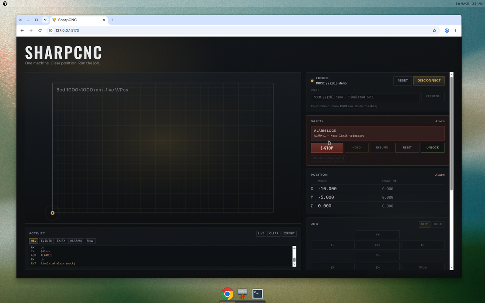
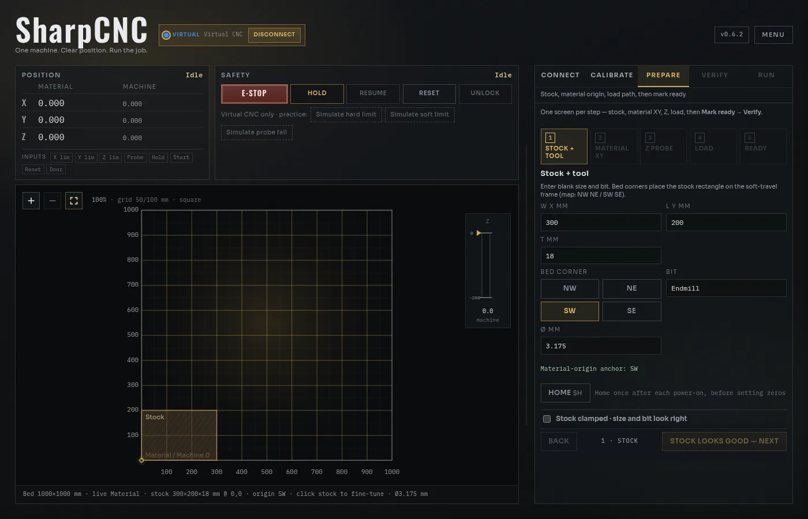
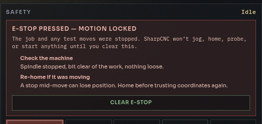

# 11. Safety notes

SharpCNC helps you see position and refuse some bad moves, but **you** are still the safety system.

> **The on-screen E-Stop is software.** It's a command sent over USB. It does nothing if the app freezes, the cable drops, the PC sleeps, or the controller locks up. Keep a **physical power cutoff** for the spindle and the steppers within arm's reach, and test it before the first real move. The enclosure Abort button is also a GRBL soft reset, not a power cut.

The **safety strip** stays visible in every phase — including before connect (Connect is the only enabled action then).

## Controls on the safety strip

| Control | Use when |
|---------|----------|
| **E-Stop** | Anything unexpected — feed hold, cancel the job and any test moves (bed travel, stock trace), soft reset, then **lock motion** until you click **Clear E-Stop** |
| **Hold** | Pause motion without full abort (`!`). Shortcut: **Space** (see below) |
| **Resume** | Continue from Hold (`~`) only if the path is still safe |
| **Reset** | Soft reset GRBL (Ctrl-X) and cancel the job — no lock afterwards. Lives only on this Safety strip (not in the header chip) |
| **Unlock** | After Alarm, once the physical cause is cleared (`$X`) |

### Keyboard shortcuts

| Key | Action |
|-----|--------|
| **Space** | **Hold** — same as the Hold button. Ignored while focus is in a text field, number input, select, or on a button / link / menu item |
| **Escape** | Closes open dialogs (Calibrate, Advanced, About, bed travel, stock perimeter, Menu). **Not** E-Stop |

There is no keyboard binding for E-Stop on purpose — Escape already dismisses dialogs, and an accidental keypress must not soft-reset the machine. Use the red **E-Stop** control (or a physical power cutoff).

Alarm banner: **Alarm lock** — jog and job Start stay refused until unlocked.

**E-Stop latch:** after E-Stop, the Safety panel shows *E-Stop pressed — motion locked*. Jog, Home, probe, calibration moves, test loops, and Start are all refused until you check the machine and click **Clear E-Stop**. This matters because GRBL is often **Idle, not Alarm,** after a soft reset at rest, so GRBL alone wouldn't stop the next command. If the machine was moving when you hit E-Stop, home again before trusting coordinates.

The dashed **Virtual CNC only · practice** buttons under the strip simulate faults on the Virtual CNC. They never appear on a real connection.

### Guided unlock

After soft-limit, hard-limit, probe-fail, or homing-fail alarms, the Safety panel shows short steps (clear the cause → unlock → re-check zeros). Unlock only when the hint says the machine is clear. **Virtual CNC** can simulate hard limit, soft limit, and probe-fail alarms for practice before real iron.

## Soft limits + Virtual practice

- Home/limit switches: **zero side only**  
- Far side: **`$130`–`$132` + `$20`** you set in Calibrate  
- UI also refuses some jogs / job starts past known travel  

Wrong numbers = false safety. Re-measure after mechanical changes.

**Before the first wood cut:** practice Connect → Calibrate → Prepare → Verify on **Virtual CNC** so soft-limit refusals and alarms are familiar. Then run the [hardware soak playbook](12-hardware-soak.md) on the real machine — home, `$3`, soft limits, Z probe, Abort/Hold/Resume, PWM. Climb the [first-test stages](13-first-test-stages.md) ladder (connect → air jog → no-tool raised Z → scrap) and only advance on **Pass**.

## Habits that prevent crashes

1. **Simulate** every new path (Verify phase).  
2. Raise Z and dry-run mentally against the visualizer stock rectangle.  
3. Start with slow jog feed near clamps and the far rails.  
4. Stay within reach of E-Stop and Demon Shield buttons while cutting.  
5. Do not leave a Running job unattended.  
6. Unlock only after you understand the alarm.  
7. Recheck **material zero** after an abort or crash.  
8. Keep hair, sleeves, and measuring tools away from a spinning spindle.

## What SharpCNC will not do for you

- Full collision detection against clamps / fixtures  
- Multi-machine interlocking  
- Remote e-stop over the network (debug bridge is read-only)  
- Perfect CAM — SVG import is simple 2D only  

## Crash / mid-job recovery

While a job runs, SharpCNC saves a **recovery checkpoint** (job name, next line, last Material/Machine). After power loss, soft reset, or Alarm:

1. Reconnect — crash recovery replaces the **Verify** screen when a checkpoint exists.  
2. Read **Where am I?** — saved vs live positions and resume line.  
3. Clear the fault → **Unlock ($X)** if Alarm.  
4. Reload the same job file if needed → **Resume from checkpoint** (sets the scrubber) → confirm clear path → **Start**.  
5. Or **Safe abort** — stop stream, spindle off, clear checkpoint.

Do not resume into clamps or an unknown Z. Re-probe when unsure.

## If something goes wrong

1. **E-Stop** (UI or hardware).  
2. Kill spindle power if needed.  
3. Open **Menu · Debug** (enable Debug mode) — filter **Alarms**, Export / Copy for later.  
4. Optional: enable [Debug bridge](10-debug-bridge.md) and share status with an agent.  
5. Use [crash / mid-job recovery](#crash--mid-job-recovery) or fix the cause → Unlock → re-zero → Simulate → careful Start.

Back to the [guide index](README.md).
